<div align="center">

# 抽象玩具铺

**二十一件毫无用途、但会让人停不下来的小东西**

零依赖 · 单文件 · 不联网也能跑

> ⚠ 本铺所有商品均无任何用途，打开即视为自愿

</div>

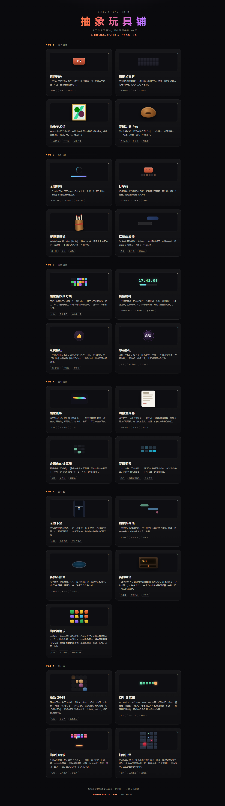

---

# Vol.1 · 初代四件

### 🧱 赛博砖头 · [`cyber-brick/`](cyber-brick/)

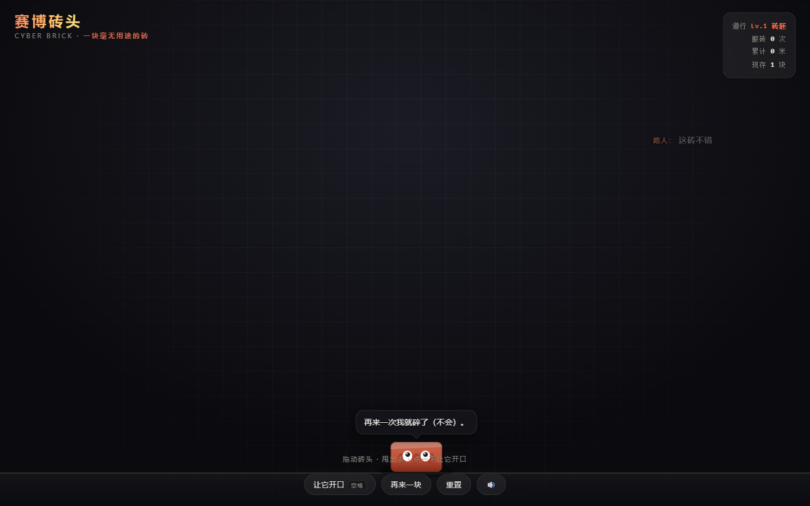

一块毫无用途的砖。拖它、甩它、听它撞墙，它会念人生哲理，还会一直盯着你的鼠标看。
搬得越多「道行」越高，砖会从红砖 → 青砖 → 金砖 → 最后的「抽象砖」一路进化。

`物理` · `哲理` · `会进化`

### 🛫 抽象公告牌 · [`cyber-sign/`](cyber-sign/)

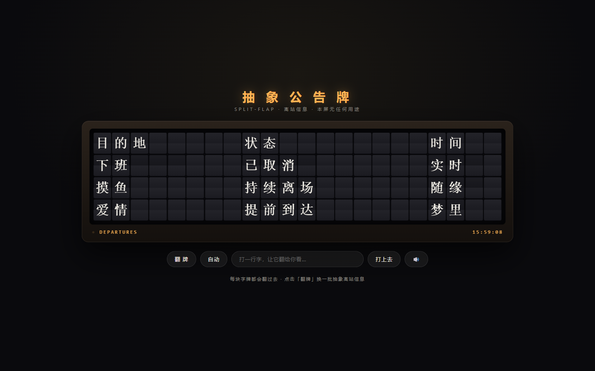

复古机场分屏翻牌机，用咔哒咔哒的声音，播报一系列永远晚点的离站信息。
每块字牌都会翻过去，也可以打你自己的字上去。

`分屏翻牌` · `音效` · `可打字`

### 🖼 抽象美术馆 · [`cyber-gallery/`](cyber-gallery/)

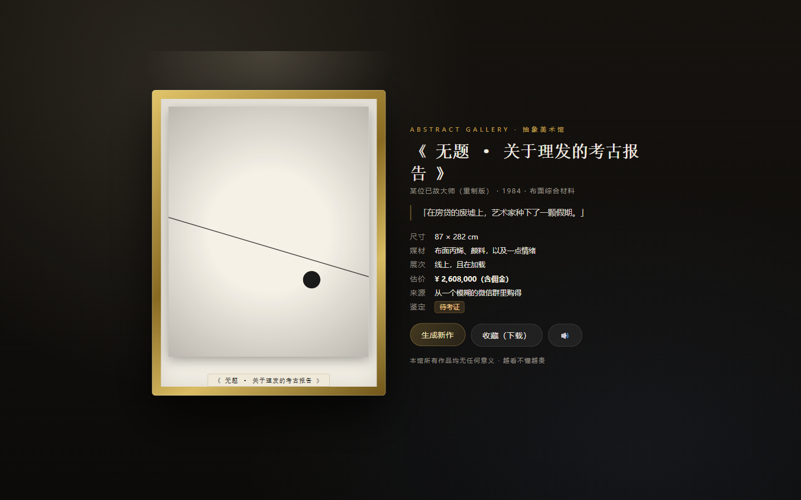

一键生成当代艺术真迹，并附上一本正经胡说八道的评论、荒谬的估价和一纸鉴定书。
看不懂就对了。可以下载收藏（会得到一张 PNG「藏品」）。

`生成艺术` · `可下载` · `胡说八道`

### 🪵 赛博功德 Pro · [`cyber-merit/`](cyber-merit/)

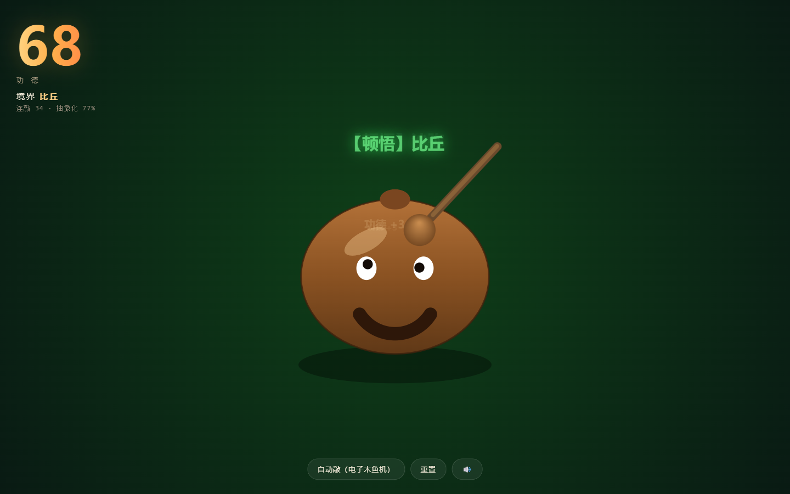

敲木鱼积功德，境界一路升到「砖」。功德越高，世界越抽象——
弹幕、故障条、佛光全都来了，木鱼自己也会睁开眼看你。

`电子木鱼` · `会失控` · `自动敲`

---

# Vol.2 · 新鲜出炉

### ⏳ 无限加载 · [`cyber-loading/`](cyber-loading/)

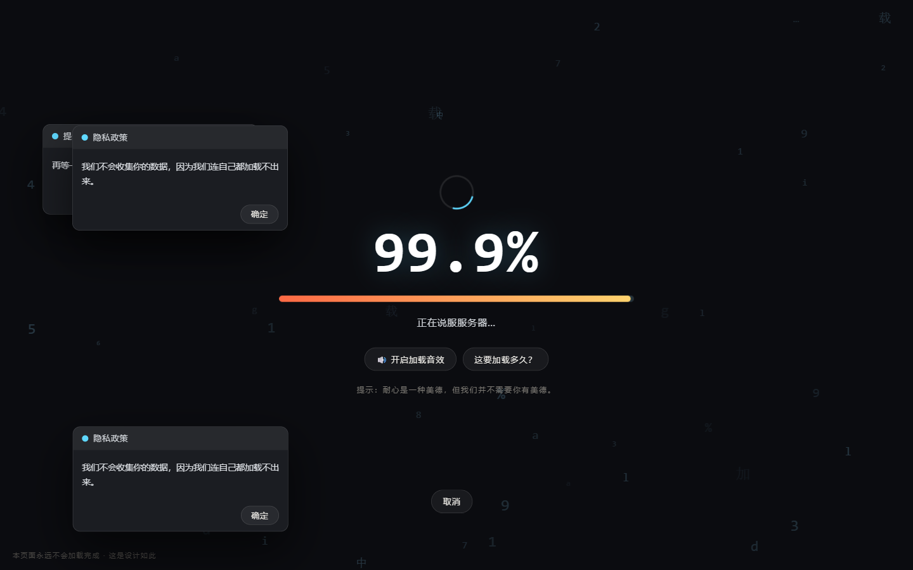

一个永远加载不完的页面。进度条会涨、会退、会卡在 99% 反复横跳，
「取消」按钮会自己跑掉，还会不停弹出一本正经的假弹窗。

`进度条谎言` · `假弹窗` · `加载音效`

### 🧱⌨️ 打字砖 · [`cyber-typer/`](cyber-typer/)

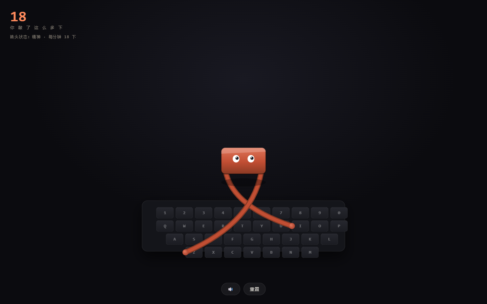

你敲键盘，砖头就伸出两条小胳膊跟着你敲。敲得越多它越累、越出汗，久了会睡着。
它还会统计你一分钟敲了多少下、累计敲了多少下。

`键盘可视化` · `会累` · `敲击音`

### 🎋 赛博求签机 · [`cyber-fortune/`](cyber-fortune/)

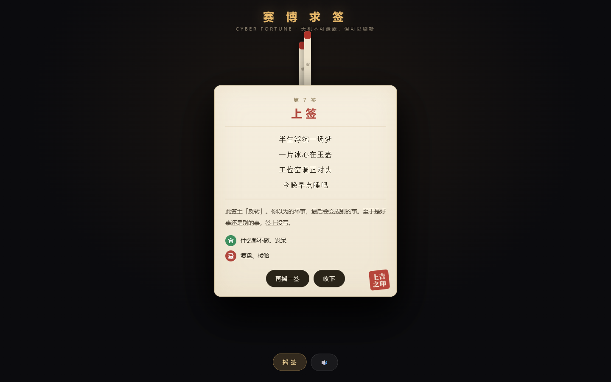

按住签筒左右摇晃，或直接点「摇 签」。抽一支出来，看看上上签配的是怎样一首
一本正经的胡说八道——外加宜忌和一枚印章。

`摇一摇` · `签诗` · `宜忌`

### 🥊 杠精生成器 · [`cyber-nitpick/`](cyber-nitpick/)

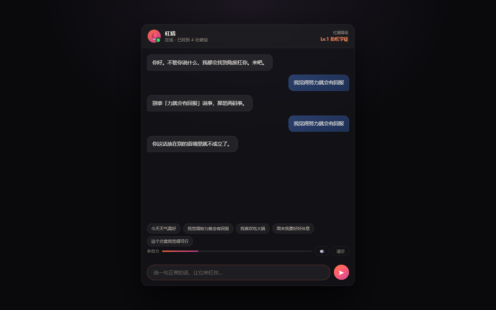

你说一句正常的话，它抬一句。你越是讲道理，它越有角度。
抬满五轮它会宣布：本回合，杠精获胜。你越较真，它越来劲。

`对话` · `会升级` · `别较真`

---

# Vol.3 · 继续加货

### 🧩 抽象俄罗斯方块 · [`cyber-tetris/`](cyber-tetris/)

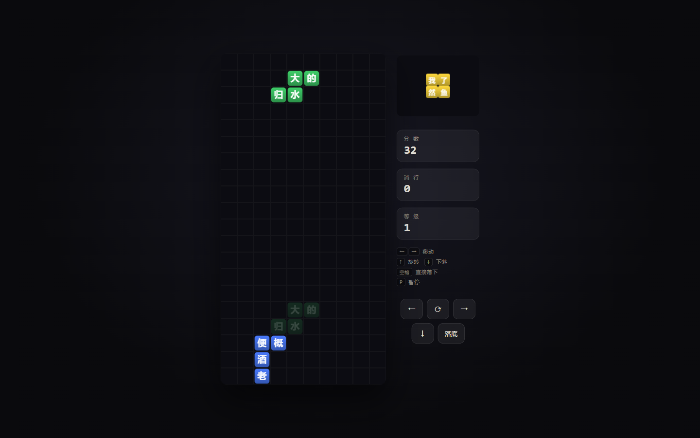

方块上全是汉字。消掉一行，就把那一行的字从左到右读成一句话，
并给出鉴定意见（「经鉴定，这是一句废话。」）。玩着玩着就开始读诗了。

**还带一个本机排行榜**：打完一局如果进了前十，可以留个名字记下来（Top 10，带分数/消行/日期），
名字会被记住，下次不用重填。榜单存在浏览器里，换台设备就不在了——
所以还做了「导出」：把成绩复制成一段 JSON 发给朋友，对方点「导入」就能看到你的分数。

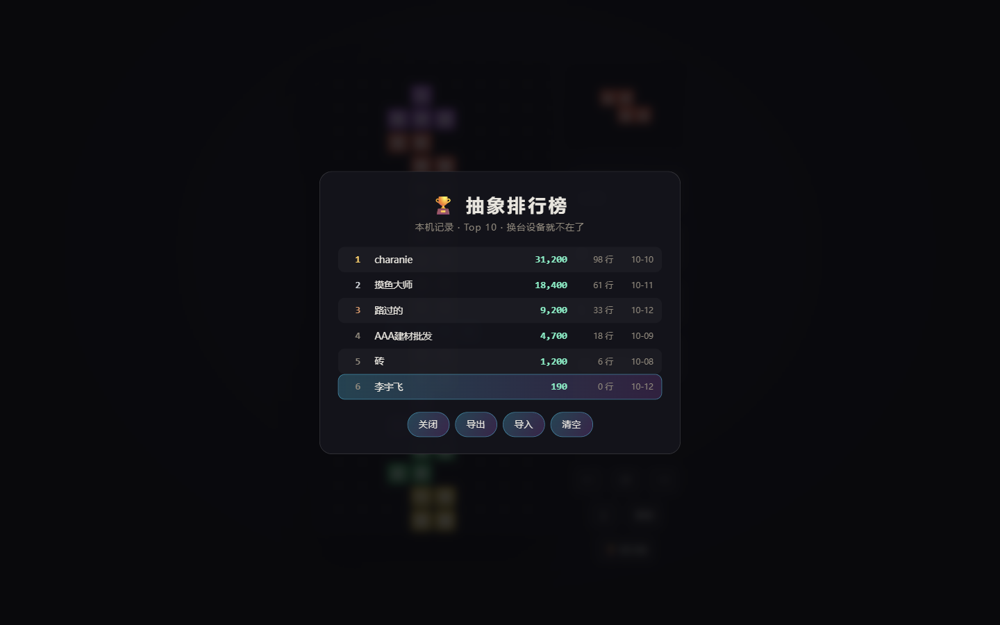

`可玩` · `自动读诗` · `本机排行榜`

### ⏰ 摸鱼时钟 · [`cyber-clock/`](cyber-clock/)

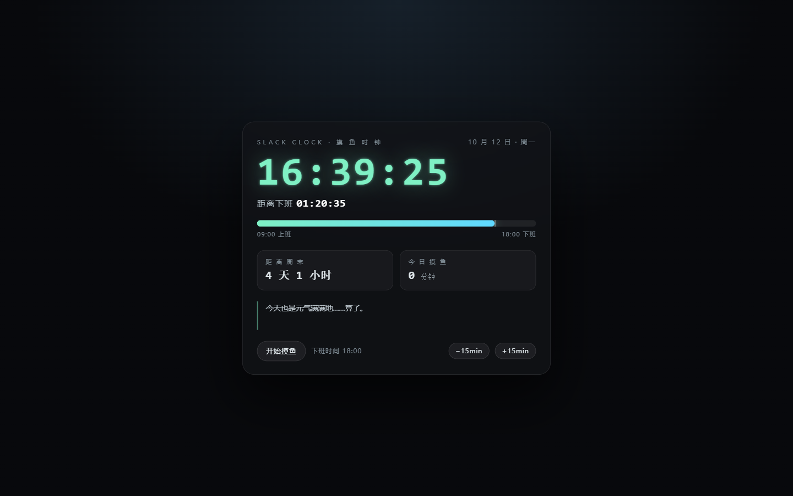

挂在屏幕上的桌面摆件：当前时间、距离下班倒计时、工作进度条、距离周末，
以及一个会自动计时的「摸鱼计时器」。下班时间可以 ±15 分钟自己调。

`下班倒计时` · `摸鱼计时` · `桌面摆件`

### 👍 点赞按钮 · [`cyber-like/`](cyber-like/)

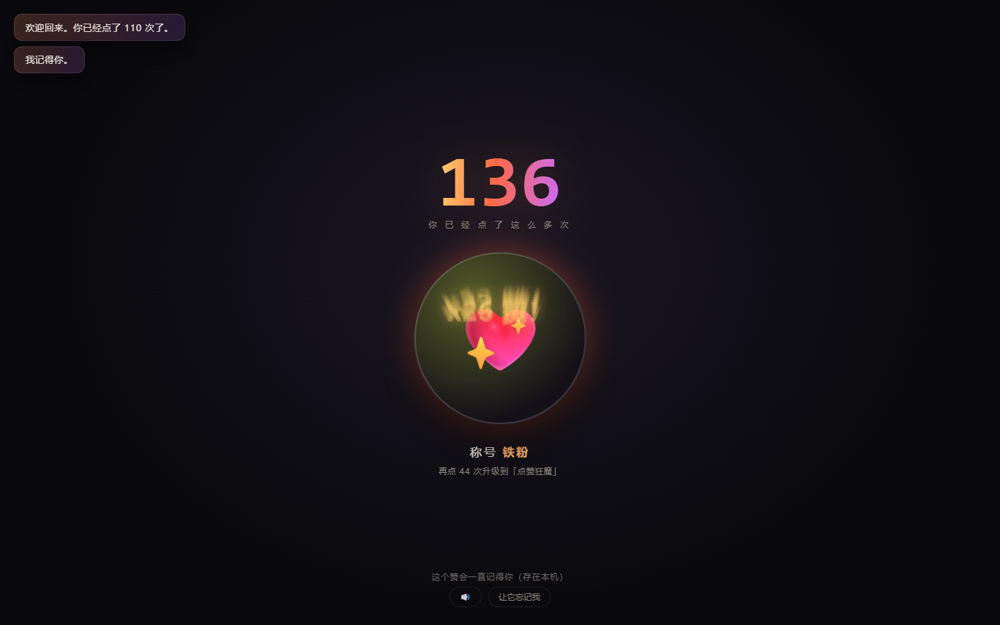

一个会记住你的按钮。点得越多它越大、越花、称号越高，
从「路过的」一路点到「摸鱼界的神」。存在本机，关掉再开它还记得你。

`会记住你` · `会升级` · `有音效`

### 🎲 命运按钮 · [`cyber-destiny/`](cyber-destiny/)


只有一个按钮。按下去，随机发生一件事——可能是字符雨、世界倒转、全屏彩虹、按钮分裂，
也可能只是一句忠告，或者一张「恭喜获得」的空头奖品。

`盲盒` · `12 种事件` · `全屏`

---

# Vol.4 · 换种玩法

### 🎨 抽象画板 · [`cyber-paint/`](cyber-paint/)

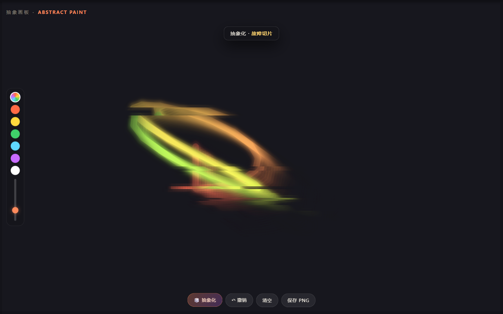

随便画点什么，然后按「抽象化」——画面被随机解构一次：左右/上下镜像、万花筒、故障切片、
色块化、反色、拖影、四方复制。可以一直按下去，越按越不像话。支持撤销和保存 PNG。

`可画` · `算法解构` · `可保存`

### 📝 周报生成器 · [`cyber-report/`](cyber-report/)


填个名字、丢几个关键词，一键生成一份看起来很像样、其实全是废话的周报：
本周工作、存在问题、下周计划一应俱全，还会自动补上「赋能」「抓手」「闭环」等黑话。
「抽象程度」从朴实一路拧到失控。

`废话文学` · `可复制` · `打工用`

### 🧮 会记仇的计算器 · [`cyber-calc/`](cyber-calc/)

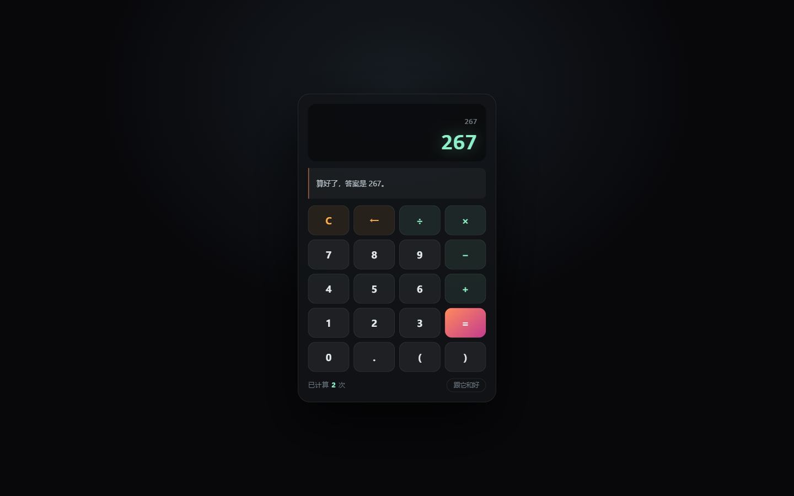

算得没错，但嘴很欠。前两次还很客气，算得越多越不耐烦，攒够次数会直接罢工；
你按 1+1 它要阴阳你一句，除以零它说那是「宇宙的尽头」。可以点「跟它和好」。

`会算` · `会阴阳` · `会罢工`

### 🎹 赛博钢琴 · [`cyber-piano/`](cyber-piano/)

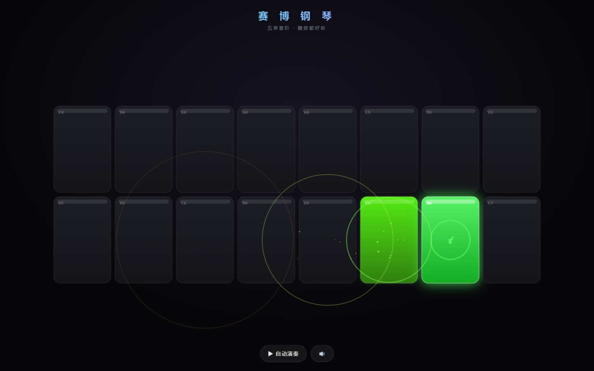

十六个方块，**五声音阶**——所以怎么按都不会难听。有涟漪、粒子和拖尾光效，
还有个「自动演奏」，它会自己弹一段随机但好听的旋律。

`发声` · `随便按都好听` · `自动演奏`

---

# Vol.5 · 凑个整

### 🕳 无限下坠 · [`cyber-fall/`](cyber-fall/)

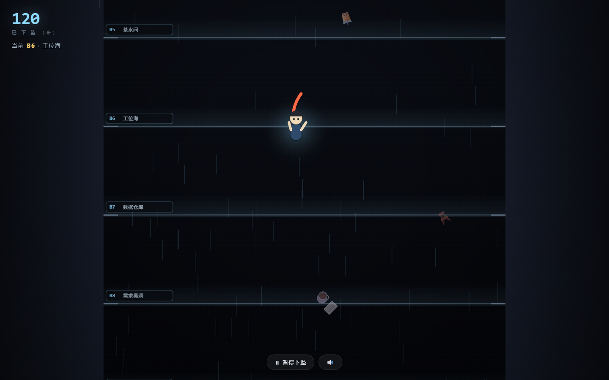

你永远在往地心坠落。一层一层从身边掠过：B5 茶水间、B7 数据仓库、B8 需求黑洞、B13 Excel 深渊……
越往下速度越快，还会飘过咖啡、外卖和键盘。左右移动鼠标（或按 ← →）控制下坠姿态。

`无限` · `视差滚动` · `打工人楼层`

### 💬 抽象弹幕墙 · [`cyber-danmaku/`](cyber-danmaku/)

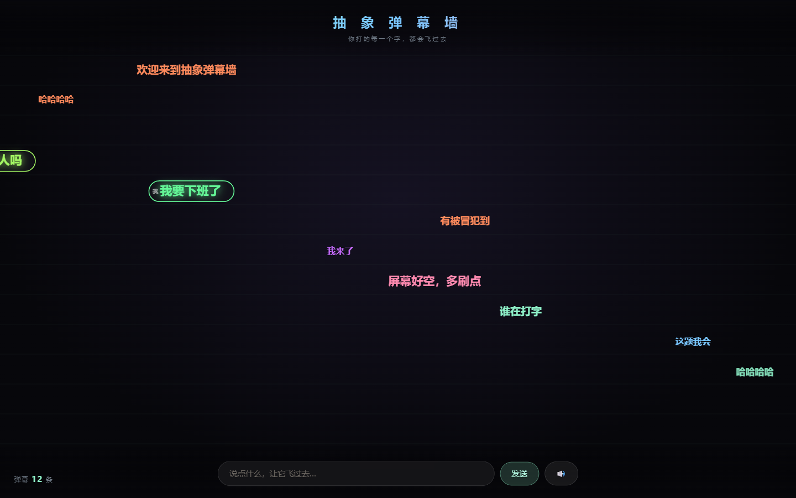

一面会自己长弹幕的墙。你打的字会带着光晕飞过去，
屏幕上也一直有别人（其实是它自己）在刷屏。

`可发送` · `自动刷屏` · `会发光`

### ⛲ 赛博许愿池 · [`cyber-wish/`](cyber-wish/)

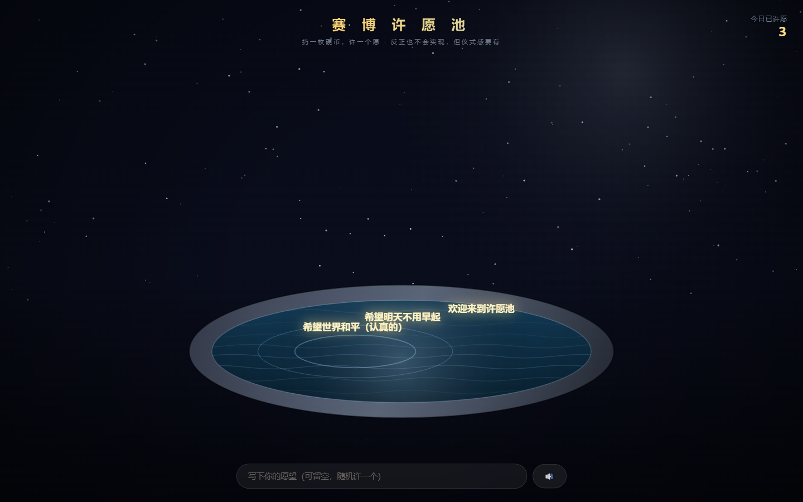

写个愿望、扔枚硬币，它会一路掉进池子里，溅起水花和涟漪，然后你的愿望会慢慢浮上来。
许愿次数存在本机，按天重置。

`扔硬币` · `有涟漪` · `会记得`

### 📻 赛博电台 · [`cyber-radio/`](cyber-radio/)

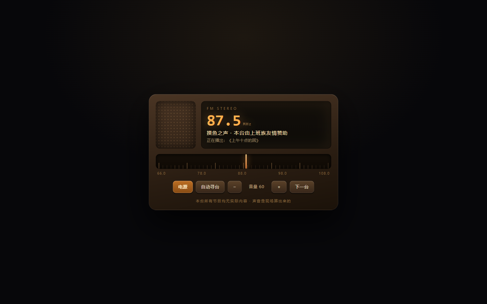

一台能调到 7 个抽象频道的收音机：摸鱼之声、深夜加班台、早八叫醒台、电梯音乐台、抽象电台……
台与台之间是沙沙声；锁定之后的声音，全是现场用一个振荡器算出来的。

`可调台` · `生成音乐` · `沙沙声`

---

# 加更 · 第 21 件

### 🍬 抽象消消乐 · [`cyber-match3/`](cyber-match3/)

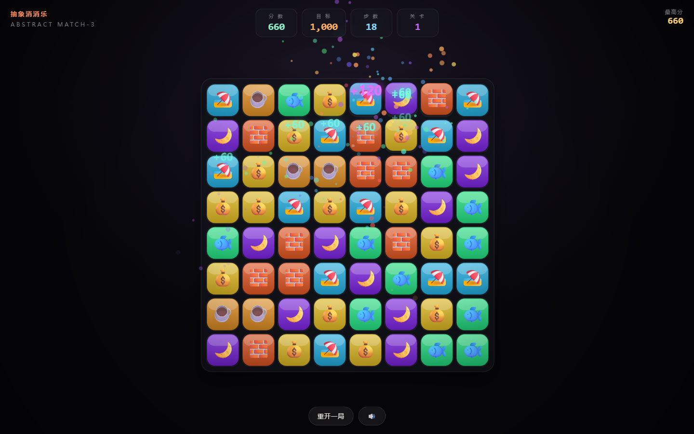

正经做了一遍的三消，不是随便连连看：

- **连锁翻倍**：一次消除后落下的方块又凑成新的，分数按连锁次数乘算，屏幕上会跳出「连锁 ×3」
- **三种特殊方块**：连成 4 个 → 🚀 火箭（清掉一整行/列）；摆成 L / T 形 → 💣 炸弹（炸掉周围 3×3）；
  连成 5 个 → 🌈 彩虹（清掉全场同色）。特殊方块再次参与消除时会连锁引爆
- **关卡制**：每关有目标分和 25 步；过关后剩余步数会折算成奖励分，下一关目标翻倍
- **防呆**：闲置 6 秒会给提示；盘面没有可行走法会自动重排；交换不成立会弹回并发出提示音
- **最高分**存在本机

主题是打工人六件套：🐟 摸鱼、🧱 搬砖、☕ 续命、🌙 加班、💰 发薪、🏖 放假。

`可玩` · `连击` · `特殊方块`

---

## 技术

- 纯 **HTML + CSS + 原生 JavaScript**，零依赖、零构建、零网络请求
- 音效全部用 **Web Audio API 程序化合成**——仓库里没有任何音频文件
- 图形用 **Canvas 2D** 实时绘制
- 自适应桌面 / 移动端

## 本地打开

直接双击根目录 `index.html` 即可；或起一个静态服务：

```bash
python -m http.server 8000
# 打开 http://localhost:8000
```

## 免责声明

本仓库所有内容均为**娱乐用途**：不含任何实际功能、不解决任何实际问题、不建议在任何严肃场合打开。
其中的「当代艺术」「鉴定书」「估值」「签文」等均为随机生成，与真实机构、市场无关。

---

愿你搬砖顺利。🧱
