<div align="center">

# 抽象玩具铺

**三十三件毫无用途、但会让人停不下来的小东西**

零依赖 · 单文件 · 不联网也能跑

> ⚠ 本铺所有商品均无任何用途，打开即视为自愿

</div>


---

# Vol.1 · 初代四件

### 🧱 赛博砖头 · [`cyber-brick/`](cyber-brick/)


一块毫无用途的砖。拖它、甩它、听它撞墙，它会念人生哲理，还会一直盯着你的鼠标看。
搬得越多「道行」越高，砖会从红砖 → 青砖 → 金砖 → 最后的「抽象砖」一路进化。

`物理` · `哲理` · `会进化`

### 🛫 抽象公告牌 · [`cyber-sign/`](cyber-sign/)


复古机场分屏翻牌机，用咔哒咔哒的声音，播报一系列永远晚点的离站信息。
每块字牌都会翻过去，也可以打你自己的字上去。

`分屏翻牌` · `音效` · `可打字`

### 🖼 抽象美术馆 · [`cyber-gallery/`](cyber-gallery/)


一键生成当代艺术真迹，并附上一本正经胡说八道的评论、荒谬的估价和一纸鉴定书。
看不懂就对了。可以下载收藏（会得到一张 PNG「藏品」）。

`生成艺术` · `可下载` · `胡说八道`

### 🪵 赛博功德 Pro · [`cyber-merit/`](cyber-merit/)


敲木鱼积功德，境界一路升到「砖」。功德越高，世界越抽象——
弹幕、故障条、佛光全都来了，木鱼自己也会睁开眼看你。

`电子木鱼` · `会失控` · `自动敲`

---

# Vol.2 · 新鲜出炉

### ⏳ 无限加载 · [`cyber-loading/`](cyber-loading/)


一个永远加载不完的页面。进度条会涨、会退、会卡在 99% 反复横跳，
「取消」按钮会自己跑掉，还会不停弹出一本正经的假弹窗。

`进度条谎言` · `假弹窗` · `加载音效`

### 🧱⌨️ 打字砖 · [`cyber-typer/`](cyber-typer/)


你敲键盘，砖头就伸出两条小胳膊跟着你敲。敲得越多它越累、越出汗，久了会睡着。
它还会统计你一分钟敲了多少下、累计敲了多少下。

`键盘可视化` · `会累` · `敲击音`

### 🎋 赛博求签机 · [`cyber-fortune/`](cyber-fortune/)


按住签筒左右摇晃，或直接点「摇 签」。抽一支出来，看看上上签配的是怎样一首
一本正经的胡说八道——外加宜忌和一枚印章。

`摇一摇` · `签诗` · `宜忌`

### 🥊 杠精生成器 · [`cyber-nitpick/`](cyber-nitpick/)


你说一句正常的话，它抬一句。你越是讲道理，它越有角度。
抬满五轮它会宣布：本回合，杠精获胜。你越较真，它越来劲。

`对话` · `会升级` · `别较真`

---

# Vol.3 · 继续加货

### 🧩 抽象俄罗斯方块 · [`cyber-tetris/`](cyber-tetris/)


方块上全是汉字。消掉一行，就把那一行的字从左到右读成一句话，
并给出鉴定意见（「经鉴定，这是一句废话。」）。玩着玩着就开始读诗了。

**还带一个本机排行榜**：打完一局如果进了前十，可以留个名字记下来（Top 10，带分数/消行/日期），
名字会被记住，下次不用重填。榜单存在浏览器里，换台设备就不在了——
所以还做了「导出」：把成绩复制成一段 JSON 发给朋友，对方点「导入」就能看到你的分数。


`可玩` · `自动读诗` · `本机排行榜`

### ⏰ 摸鱼时钟 · [`cyber-clock/`](cyber-clock/)


挂在屏幕上的桌面摆件：当前时间、距离下班倒计时、工作进度条、距离周末，
以及一个会自动计时的「摸鱼计时器」。下班时间可以 ±15 分钟自己调。

`下班倒计时` · `摸鱼计时` · `桌面摆件`

### 👍 点赞按钮 · [`cyber-like/`](cyber-like/)


一个会记住你的按钮。点得越多它越大、越花、称号越高，
从「路过的」一路点到「摸鱼界的神」。存在本机，关掉再开它还记得你。

`会记住你` · `会升级` · `有音效`

### 🎲 命运按钮 · [`cyber-destiny/`](cyber-destiny/)


只有一个按钮。按下去，随机发生一件事——可能是字符雨、世界倒转、全屏彩虹、按钮分裂，
也可能只是一句忠告，或者一张「恭喜获得」的空头奖品。

`盲盒` · `12 种事件` · `全屏`

---

# Vol.4 · 换种玩法

### 🎨 抽象画板 · [`cyber-paint/`](cyber-paint/)


随便画点什么，然后按「抽象化」——画面被随机解构一次：左右/上下镜像、万花筒、故障切片、
色块化、反色、拖影、四方复制。可以一直按下去，越按越不像话。支持撤销和保存 PNG。

`可画` · `算法解构` · `可保存`

### 📝 周报生成器 · [`cyber-report/`](cyber-report/)


填个名字、丢几个关键词，一键生成一份看起来很像样、其实全是废话的周报：
本周工作、存在问题、下周计划一应俱全，还会自动补上「赋能」「抓手」「闭环」等黑话。
「抽象程度」从朴实一路拧到失控。

`废话文学` · `可复制` · `打工用`

### 🧮 会记仇的计算器 · [`cyber-calc/`](cyber-calc/)


算得没错，但嘴很欠。前两次还很客气，算得越多越不耐烦，攒够次数会直接罢工；
你按 1+1 它要阴阳你一句，除以零它说那是「宇宙的尽头」。可以点「跟它和好」。

`会算` · `会阴阳` · `会罢工`

### 🎹 赛博钢琴 · [`cyber-piano/`](cyber-piano/)


十六个方块，**五声音阶**——所以怎么按都不会难听。有涟漪、粒子和拖尾光效，
还有个「自动演奏」，它会自己弹一段随机但好听的旋律。

`发声` · `随便按都好听` · `自动演奏`

---

# Vol.5 · 凑个整

### 🕳 无限下坠 · [`cyber-fall/`](cyber-fall/)


你永远在往地心坠落。一层一层从身边掠过：B5 茶水间、B7 数据仓库、B8 需求黑洞、B13 Excel 深渊……
越往下速度越快，还会飘过咖啡、外卖和键盘。左右移动鼠标（或按 ← →）控制下坠姿态。

`无限` · `视差滚动` · `打工人楼层`

### 💬 抽象弹幕墙 · [`cyber-danmaku/`](cyber-danmaku/)


一面会自己长弹幕的墙。你打的字会带着光晕飞过去，
屏幕上也一直有别人（其实是它自己）在刷屏。

`可发送` · `自动刷屏` · `会发光`

### ⛲ 赛博许愿池 · [`cyber-wish/`](cyber-wish/)


写个愿望、扔枚硬币，它会一路掉进池子里，溅起水花和涟漪，然后你的愿望会慢慢浮上来。
许愿次数存在本机，按天重置。

`扔硬币` · `有涟漪` · `会记得`

### 📻 赛博电台 · [`cyber-radio/`](cyber-radio/)


一台能调到 7 个抽象频道的收音机：摸鱼之声、深夜加班台、早八叫醒台、电梯音乐台、抽象电台……
台与台之间是沙沙声；锁定之后的声音，全是现场用一个振荡器算出来的。

`可调台` · `生成音乐` · `沙沙声`

---

# 加更 · 第 21 件

### 🍬 抽象消消乐 · [`cyber-match3/`](cyber-match3/)


正经做了一遍的三消，不是随便连连看：

- **连锁翻倍**：一次消除后落下的方块又凑成新的，分数按连锁次数乘算，屏幕上会跳出「连锁 ×3」
- **三种特殊方块**：连成 4 个 → 🚀 火箭（清掉一整行/列）；摆成 L / T 形 → 💣 炸弹（炸掉周围 3×3）；
  连成 5 个 → 🌈 彩虹（清掉全场同色）。特殊方块再次参与消除时会连锁引爆
- **关卡制**：每关有目标分和 25 步；过关后剩余步数会折算成奖励分，下一关目标翻倍
- **防呆**：闲置 6 秒会给提示；盘面没有可行走法会自动重排；交换不成立会弹回并发出提示音
- **最高分**存在本机

主题是打工人六件套：🐟 摸鱼、🧱 搬砖、☕ 续命、🌙 加班、💰 发薪、🏖 放假。

**每日挑战**：用日期当随机种子，**所有人当天拿到的是同一副牌**，30 步、目标 4000 分，
比的就是当天谁打得高。（实测同一日期加载两次，牌面像素级一致。）

**联网排行榜**：常规榜 / 今日挑战榜两张榜，打完自动提交，能看到自己的名次。
后端是一个 Cloudflare Worker + KV，部署方法见 [`server/README.md`](server/README.md)，
地址填在根目录的 [`config.js`](config.js) 里。没配后端就自动退回本机榜，功能不缺席。

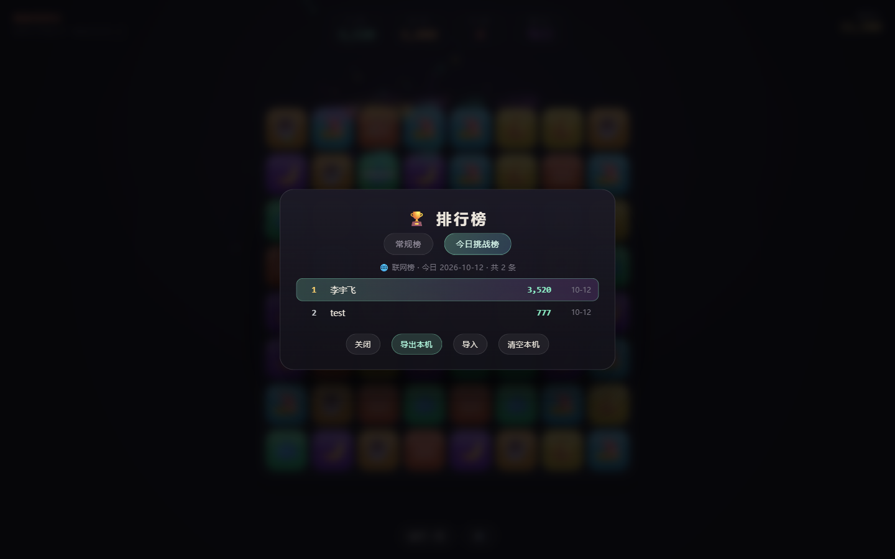

`可玩` · `每日挑战` · `联网排行榜`

---

# VOL.6 · 能玩的

前面都是摆件，这一卷是四个正经能玩的：都是经典玩法的底子，套上本铺的皮。
零依赖、单文件、不联网照样跑，各自把最好成绩存在本机。

### 🔢 抽象 2048 · [`cyber-2048/`](cyber-2048/)

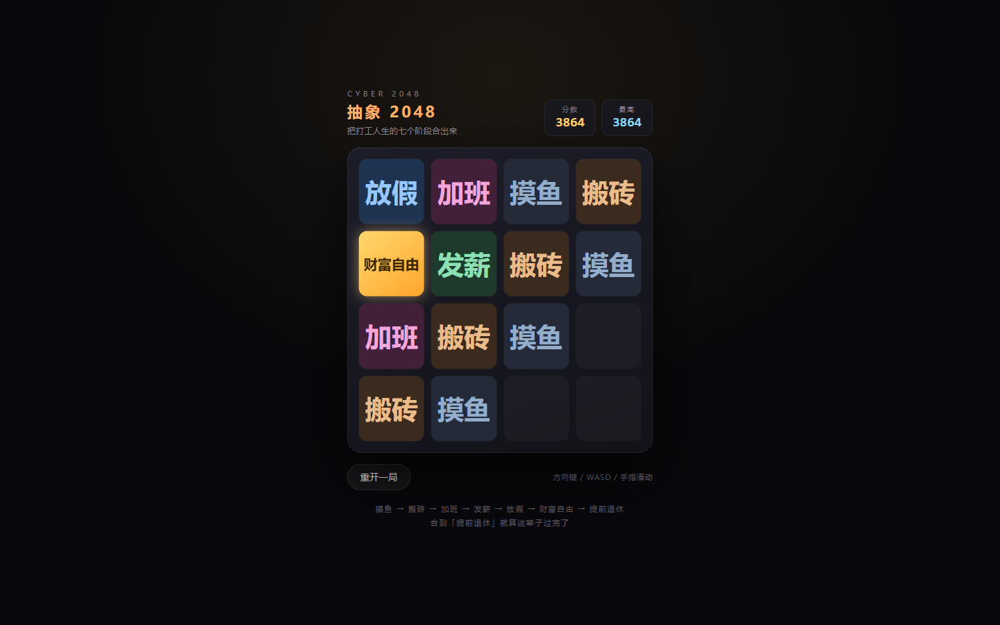

四方格里合成打工人生的七个阶段：**摸鱼 → 搬砖 → 加班 → 发薪 → 放假 → 财富自由 → 提前退休**。
方块合上去会有弹一下的手感，合到最高的「提前退休」会弹一张庆祝卡片，你可以选择接着合。
方向键、WASD、手机手指滑动都能玩；盘面走不动了会自动判定「卡住了」。

`可玩` · `会合并` · `有最高分`

### 🐍 KPI 贪吃蛇 · [`cyber-snake/`](cyber-snake/)

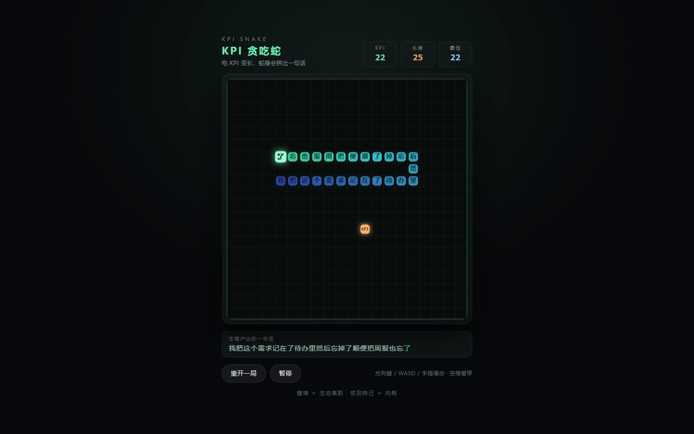

吃 KPI 变长，越吃越快（165ms → 最快 72ms 一步）。
撞墙＝**主动离职**，咬到自己＝**内耗**，两种死法各有各的台词。

最好玩的是：**蛇身每一节都是一个汉字**，从尾到头读出来正好是一句话——
你吃得越多那句话越长，而且中途会随机接到下一句上，于是越读越离谱。
死的时候它会把你这一局「产出」的那句话裱起来，再配一句鉴定。

`可玩` · `会念句子` · `音效`

### 🧱 抽象打砖块 · [`cyber-breakout/`](cyber-breakout/)

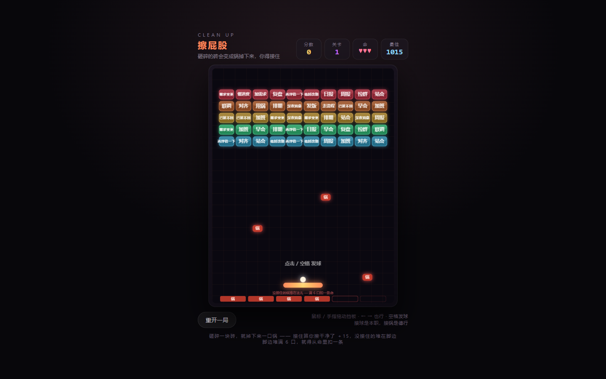

本铺吉祥物当主角。砖块上写着早会、周报、需求变更、已读不回、甩锅、对齐、复盘……
一块一块砸穿，碎砖会爆出一小片粒子。

三种掉落道具：**●●● 多球**、**↔ 加长挡板**、**🐌 慢速**。
砸完一面进下一关，砖越来越多、球越来越快、挡板越来越短。三条命用完就「下班了」。

`可玩` · `三种道具` · `手感爽`

### 💥 抽象扫雷 · [`cyber-mines/`](cyber-mines/)

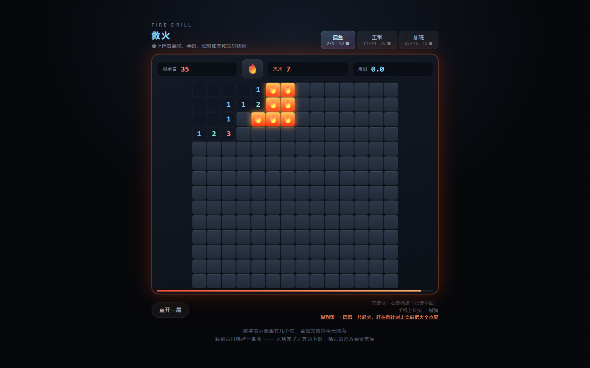

经典扫雷的底子，格子底下埋的是**需求、会议、临时加塞、领导找你**（踩到哪颗就报哪颗的名字）。
数字表示周围有几个坑，插旗就是「**已读不回**」。第一次点击保证安全，数字上右键/双击可以「和弦」一键展开。

三档难度：**摸鱼 9×9 · 10 雷 / 正常 14×14 · 35 雷 / 加班 20×16 · 75 雷**，
每一档各自记最快通关时间。手机上长按格子＝插旗。

`可玩` · `三档难度` · `记纪录`

---

# VOL.7 · 继续能玩

### 📦 抽象推箱子 · [`cyber-sokoban/`](cyber-sokoban/)

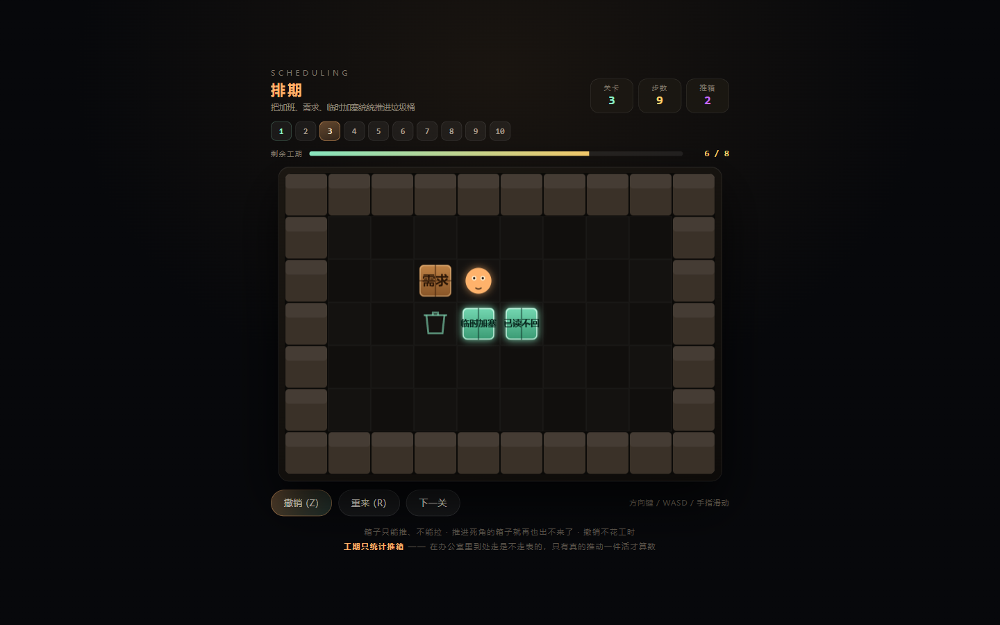

把加班、需求、临时加塞一个个推进垃圾桶。**十关手工设计**的关卡，难度从「推一下就完事」
一路走到「得先绕到另一侧再把它顶上去」。

箱子**只能推、不能拉**，推进死角的箱子就再也出不来了——这是唯一会让人拍大腿的规则。
带撤销（Z）、重来（R）、步数/推箱统计，进度存在本机。

`可玩` · `十关` · `解谜`

### 🔨 抽象打地鼠 · [`cyber-mole/`](cyber-mole/)

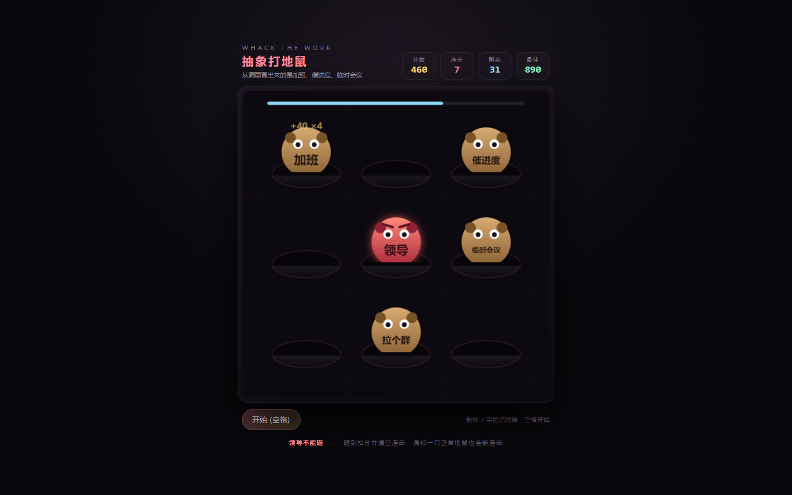

洞里冒出来的是加班、催进度、临时会议、拉个群、改一版，拿锤子砸。3×3 九个洞，45 秒。

- **连击**：连续砸中倍率一路涨到 ×5，漏掉一只或者点空就断
- **领导混进来**：红色的、皱着眉的那只，砸到扣 20 分还清空连击
- 越到后面冒得越快、停得越短，领导出现的概率也从 6% 涨到 26%

`可玩` · `45 秒` · `连击`

### 🦘 一键跳 KPI · [`cyber-jump/`](cyber-jump/)

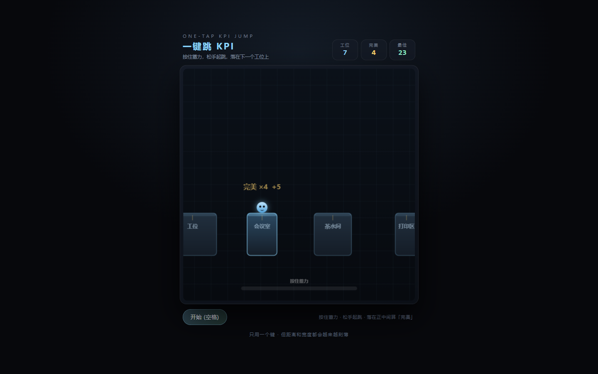

按住蓄力、松手起跳，落到下一个工位上（工位、会议室、茶水间、打印区、电梯口……）。
**只有一个键**，但工位会越来越窄（118 → 44）、越来越远。

落在正中间算「完美」，连续完美有递增的额外加分。掉下去就结算，记最远距离。

`可玩` · `一个键` · `记最远`

### ⚫ 五子棋 vs 杠精 · [`cyber-gomoku/`](cyber-gomoku/)

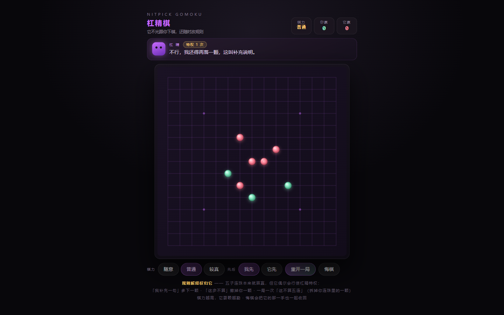

跟铺子里那位杠精坐下来下一盘。它会认真下棋，**也会嘴你**——
你每落一子它评一句，你凑出活三它还要再阴阳一句，你输了它更要说话。

三档棋力（随意 / 普通 / 较真），可选先手后手，能悔棋（会把它的那一手一并收回）。
AI 用棋型打分（活四、冲四、活三、跳三……约 23 种模式）加两回合前瞻，
**你凑出四连它一定来挡，它自己能连五就一定连**。

`可玩` · `有 AI` · `会对线`

---

# VOL.8 · 音游四件

**这一卷的四件共用同一套做法，而且它才是重点：**

- **曲子在运行时现场算出来**——bpm、调式、鼓组、贝斯、和弦、旋律全用 Web Audio 合成，
  用种子固定，所以每次打开听到的是同一首。仓库里**依然没有一个音频文件**。
- **谱面不是手写的，是从曲子里长出来的**——先把这首歌生成成一串音符事件，
  再按十六分音符网格采样：难度只决定「每隔几格取一个」。所以加歌、加难度都不用写谱。
- **计时走 `AudioContext.currentTime`（采样级）**，配合前瞻调度器提前排音，
  而不是 `performance.now()`——这是音游判定准不准的分水岭。

四首曲子各配一套：**周一早八 / 需求又变了 / 摸鱼进行曲 / 下班倒计时**（太鼓那件是
早操进行曲 / 赶地铁 / 午休半小时 / 领导来了）。

### ⌨️ 抽象落键 · [`cyber-keys/`](cyber-keys/)

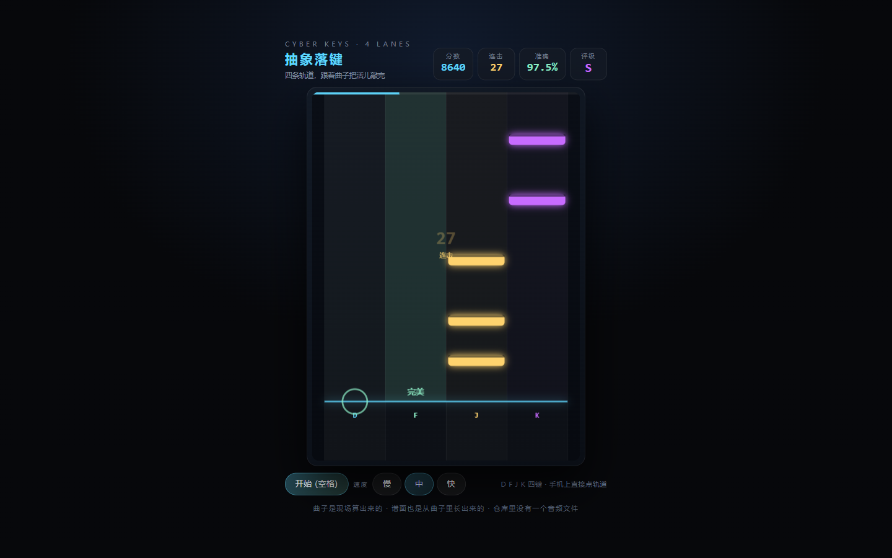

四轨下落式，D / F / J / K 四键。判定分**完美（±45ms）/ 良好（±90ms）/ 凑合（±140ms）/ 错过**，
带连击加成、准确率和 S/A/B/C/D 评级。三档难度、三档下落速度，手机上直接点轨道。

`可玩` · `四轨` · `四首曲子`

### 🥁 抽象太鼓 · [`cyber-taiko/`](cyber-taiko/)

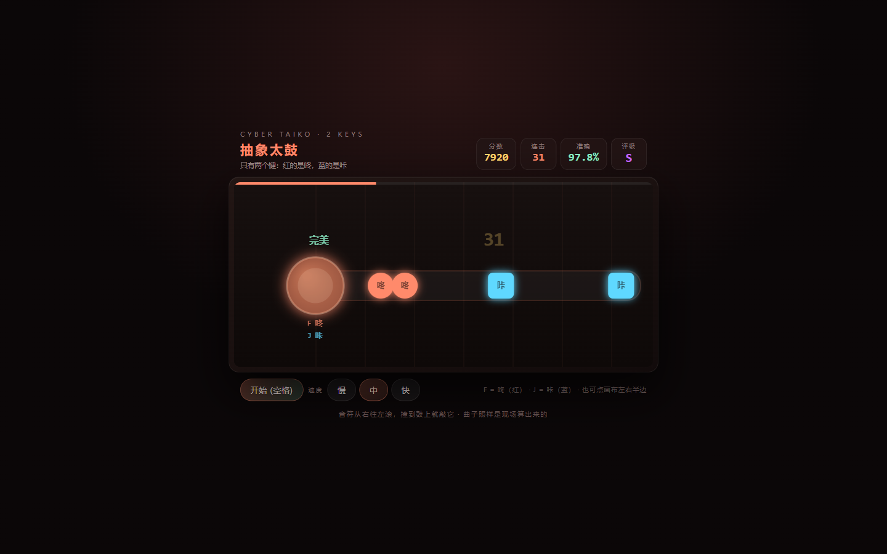

只有两个键：**红的是咚（F）、蓝的是咔（J）**。音符从右往左滚，撞到鼓上就敲。
上手的门槛是五秒，但节奏一密就手忙脚乱。

`可玩` · `两个键` · `上手快`

### 🎯 抽象点音 · [`cyber-tap/`](cyber-tap/)

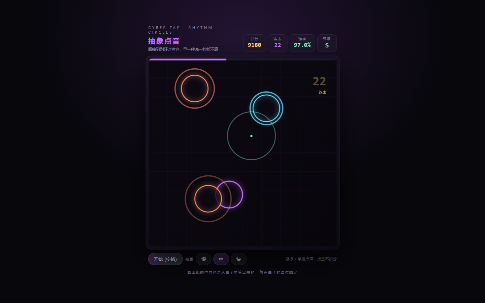

圈一个个冒出来，缩到刚好时点它，**早一秒晚一秒都不算**。点空不扣分。
圈的位置也是从曲子里算出来的（同一首曲子圈位固定），手机上最好玩的一个。

`可玩` · `手机友好` · `好看`

### 🏃 抽象节奏跑 · [`cyber-beatrun/`](cyber-beatrun/)

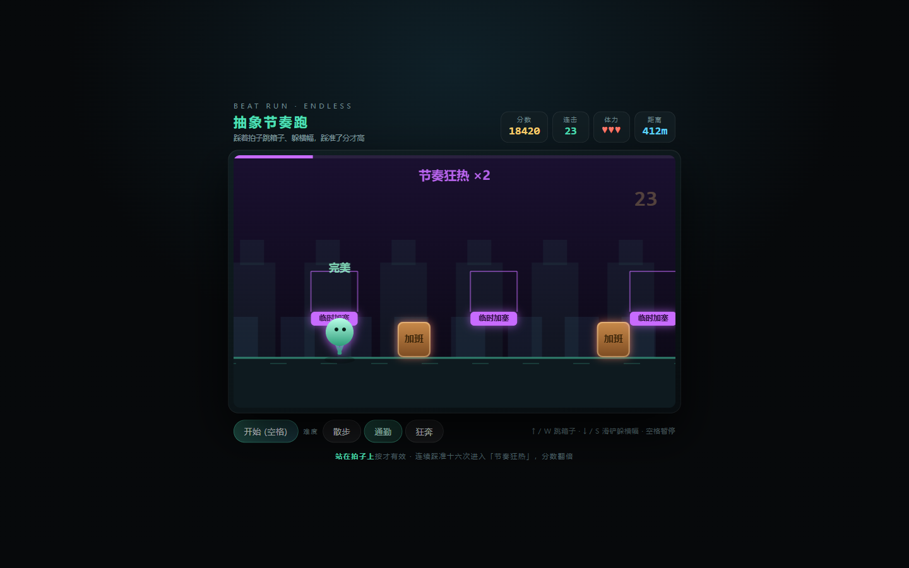

人自动往前跑，你得**踩着拍子跳箱子（咚）、滑铲躲横幅（咔）**。
踩得越准分越高，连续踩准十六次进「节奏狂热」分数翻倍。撞三次就摔。

`可玩` · `无限跑` · `有狂热`

---

## 技术

- 纯 **HTML + CSS + 原生 JavaScript**，零依赖、零构建、零网络请求
- 音效全部用 **Web Audio API 程序化合成**——仓库里没有任何音频文件
- 图形用 **Canvas 2D** 实时绘制
- 自适应桌面 / 移动端

## 本地打开

直接双击根目录 `index.html` 即可；或起一个静态服务：

```bash
python -m http.server 8000
# 打开 http://localhost:8000
```

## 免责声明

本仓库所有内容均为**娱乐用途**：不含任何实际功能、不解决任何实际问题、不建议在任何严肃场合打开。
其中的「当代艺术」「鉴定书」「估值」「签文」等均为随机生成，与真实机构、市场无关。

---

愿你搬砖顺利。🧱
