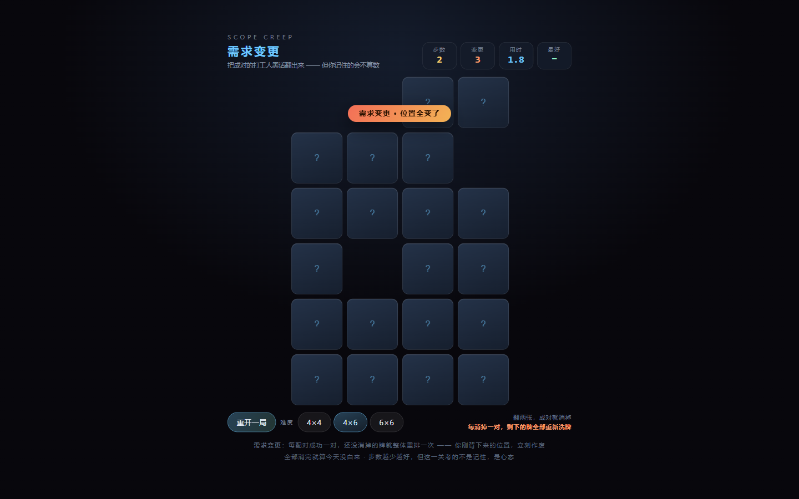
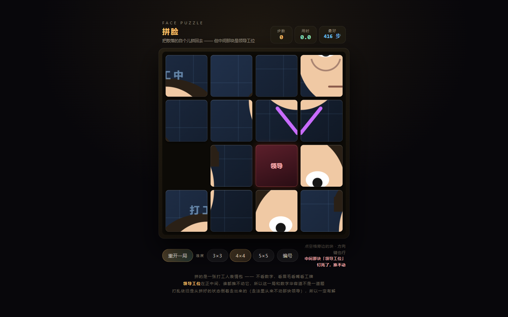
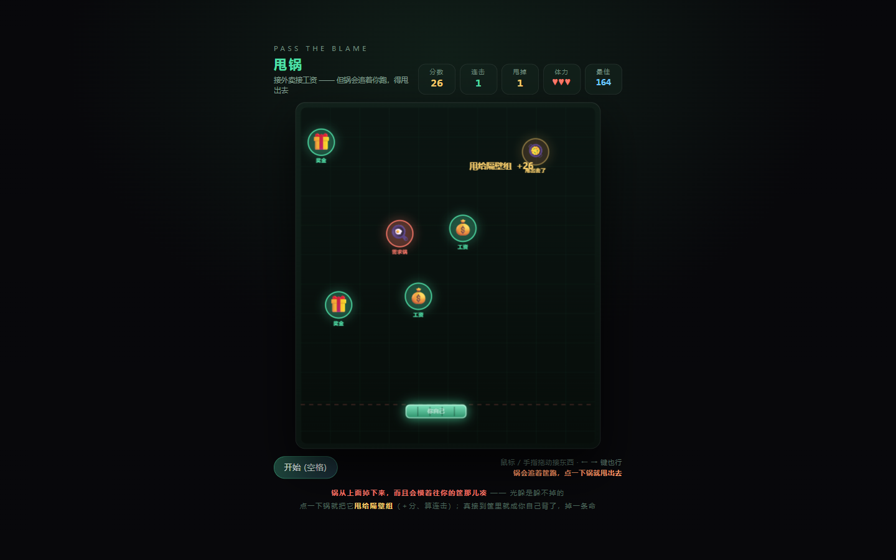
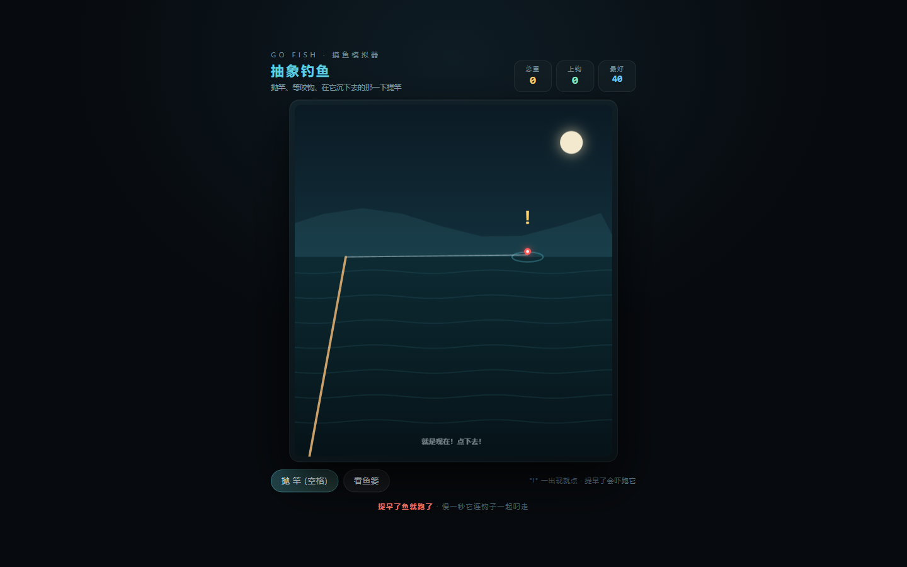
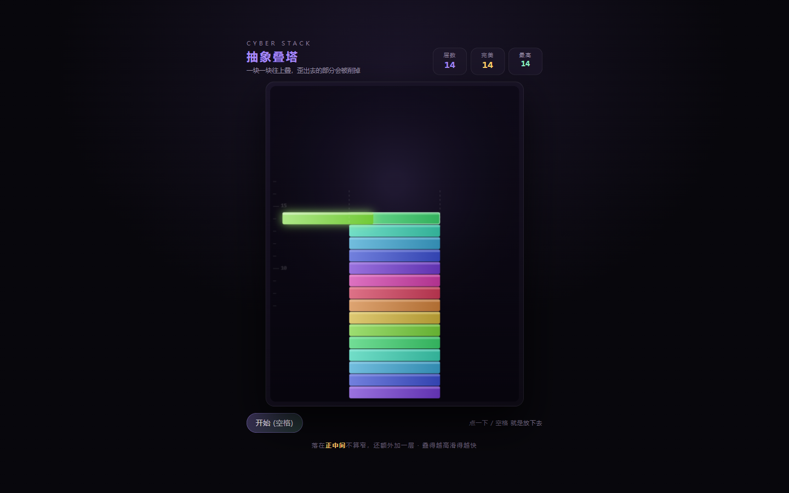
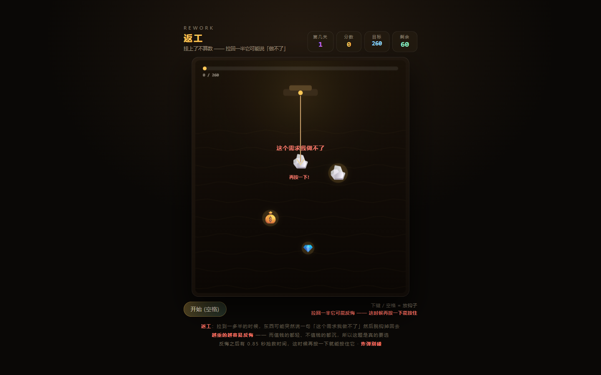
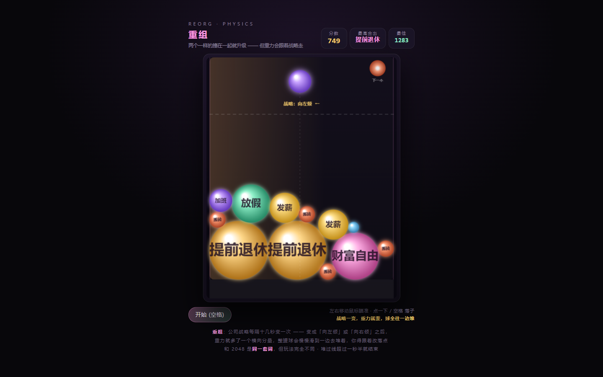

<div align="center">

# 抽象玩具铺

**四十件毫无用途、但会让人停不下来的小东西**

零依赖 · 单文件 · 不联网也能跑

> ⚠ 本铺所有商品均无任何用途，打开即视为自愿

</div>


---

# Vol.1 · 初代四件

### 🧱 赛博砖头 · [`cyber-brick/`](cyber-brick/)


一块毫无用途的砖。拖它、甩它、听它撞墙，它会念人生哲理，还会一直盯着你的鼠标看。
搬得越多「道行」越高，砖会从红砖 → 青砖 → 金砖 → 最后的「抽象砖」一路进化。

`物理` · `哲理` · `会进化`

### 🛫 抽象公告牌 · [`cyber-sign/`](cyber-sign/)


复古机场分屏翻牌机，用咔哒咔哒的声音，播报一系列永远晚点的离站信息。
每块字牌都会翻过去，也可以打你自己的字上去。

`分屏翻牌` · `音效` · `可打字`

### 🖼 抽象美术馆 · [`cyber-gallery/`](cyber-gallery/)


一键生成当代艺术真迹，并附上一本正经胡说八道的评论、荒谬的估价和一纸鉴定书。
看不懂就对了。可以下载收藏（会得到一张 PNG「藏品」）。

`生成艺术` · `可下载` · `胡说八道`

### 🪵 赛博功德 Pro · [`cyber-merit/`](cyber-merit/)


敲木鱼积功德，境界一路升到「砖」。功德越高，世界越抽象——
弹幕、故障条、佛光全都来了，木鱼自己也会睁开眼看你。

`电子木鱼` · `会失控` · `自动敲`

---

# Vol.2 · 新鲜出炉

### ⏳ 无限加载 · [`cyber-loading/`](cyber-loading/)


一个永远加载不完的页面。进度条会涨、会退、会卡在 99% 反复横跳，
「取消」按钮会自己跑掉，还会不停弹出一本正经的假弹窗。

`进度条谎言` · `假弹窗` · `加载音效`

### 🧱⌨️ 打字砖 · [`cyber-typer/`](cyber-typer/)


你敲键盘，砖头就伸出两条小胳膊跟着你敲。敲得越多它越累、越出汗，久了会睡着。
它还会统计你一分钟敲了多少下、累计敲了多少下。

`键盘可视化` · `会累` · `敲击音`

### 🎋 赛博求签机 · [`cyber-fortune/`](cyber-fortune/)


按住签筒左右摇晃，或直接点「摇 签」。抽一支出来，看看上上签配的是怎样一首
一本正经的胡说八道——外加宜忌和一枚印章。

`摇一摇` · `签诗` · `宜忌`

### 🥊 杠精生成器 · [`cyber-nitpick/`](cyber-nitpick/)


你说一句正常的话，它抬一句。你越是讲道理，它越有角度。
抬满五轮它会宣布：本回合，杠精获胜。你越较真，它越来劲。

`对话` · `会升级` · `别较真`

---

# Vol.3 · 继续加货

### 🧩 抽象俄罗斯方块 · [`cyber-tetris/`](cyber-tetris/)


方块上全是汉字。消掉一行，就把那一行的字从左到右读成一句话，
并给出鉴定意见（「经鉴定，这是一句废话。」）。玩着玩着就开始读诗了。

**还带一个本机排行榜**：打完一局如果进了前十，可以留个名字记下来（Top 10，带分数/消行/日期），
名字会被记住，下次不用重填。榜单存在浏览器里，换台设备就不在了——
所以还做了「导出」：把成绩复制成一段 JSON 发给朋友，对方点「导入」就能看到你的分数。


`可玩` · `自动读诗` · `本机排行榜`

### ⏰ 摸鱼时钟 · [`cyber-clock/`](cyber-clock/)


挂在屏幕上的桌面摆件：当前时间、距离下班倒计时、工作进度条、距离周末，
以及一个会自动计时的「摸鱼计时器」。下班时间可以 ±15 分钟自己调。

`下班倒计时` · `摸鱼计时` · `桌面摆件`

### 👍 点赞按钮 · [`cyber-like/`](cyber-like/)


一个会记住你的按钮。点得越多它越大、越花、称号越高，
从「路过的」一路点到「摸鱼界的神」。存在本机，关掉再开它还记得你。

`会记住你` · `会升级` · `有音效`

### 🎲 命运按钮 · [`cyber-destiny/`](cyber-destiny/)


只有一个按钮。按下去，随机发生一件事——可能是字符雨、世界倒转、全屏彩虹、按钮分裂，
也可能只是一句忠告，或者一张「恭喜获得」的空头奖品。

`盲盒` · `12 种事件` · `全屏`

---

# Vol.4 · 换种玩法

### 🎨 抽象画板 · [`cyber-paint/`](cyber-paint/)


随便画点什么，然后按「抽象化」——画面被随机解构一次：左右/上下镜像、万花筒、故障切片、
色块化、反色、拖影、四方复制。可以一直按下去，越按越不像话。支持撤销和保存 PNG。

`可画` · `算法解构` · `可保存`

### 📝 周报生成器 · [`cyber-report/`](cyber-report/)


填个名字、丢几个关键词，一键生成一份看起来很像样、其实全是废话的周报：
本周工作、存在问题、下周计划一应俱全，还会自动补上「赋能」「抓手」「闭环」等黑话。
「抽象程度」从朴实一路拧到失控。

`废话文学` · `可复制` · `打工用`

### 🧮 会记仇的计算器 · [`cyber-calc/`](cyber-calc/)


算得没错，但嘴很欠。前两次还很客气，算得越多越不耐烦，攒够次数会直接罢工；
你按 1+1 它要阴阳你一句，除以零它说那是「宇宙的尽头」。可以点「跟它和好」。

`会算` · `会阴阳` · `会罢工`

### 🎹 赛博钢琴 · [`cyber-piano/`](cyber-piano/)


十六个方块，**五声音阶**——所以怎么按都不会难听。有涟漪、粒子和拖尾光效，
还有个「自动演奏」，它会自己弹一段随机但好听的旋律。

`发声` · `随便按都好听` · `自动演奏`

---

# Vol.5 · 凑个整

### 🕳 无限下坠 · [`cyber-fall/`](cyber-fall/)


你永远在往地心坠落。一层一层从身边掠过：B5 茶水间、B7 数据仓库、B8 需求黑洞、B13 Excel 深渊……
越往下速度越快，还会飘过咖啡、外卖和键盘。左右移动鼠标（或按 ← →）控制下坠姿态。

`无限` · `视差滚动` · `打工人楼层`

### 💬 抽象弹幕墙 · [`cyber-danmaku/`](cyber-danmaku/)


一面会自己长弹幕的墙。你打的字会带着光晕飞过去，
屏幕上也一直有别人（其实是它自己）在刷屏。

`可发送` · `自动刷屏` · `会发光`

### ⛲ 赛博许愿池 · [`cyber-wish/`](cyber-wish/)


写个愿望、扔枚硬币，它会一路掉进池子里，溅起水花和涟漪，然后你的愿望会慢慢浮上来。
许愿次数存在本机，按天重置。

`扔硬币` · `有涟漪` · `会记得`

### 📻 赛博电台 · [`cyber-radio/`](cyber-radio/)


一台能调到 7 个抽象频道的收音机：摸鱼之声、深夜加班台、早八叫醒台、电梯音乐台、抽象电台……
台与台之间是沙沙声；锁定之后的声音，全是现场用一个振荡器算出来的。

`可调台` · `生成音乐` · `沙沙声`

---

# 加更 · 第 21 件

### 🍬 抽象消消乐 · [`cyber-match3/`](cyber-match3/)


正经做了一遍的三消，不是随便连连看：

- **连锁翻倍**：一次消除后落下的方块又凑成新的，分数按连锁次数乘算，屏幕上会跳出「连锁 ×3」
- **三种特殊方块**：连成 4 个 → 🚀 火箭（清掉一整行/列）；摆成 L / T 形 → 💣 炸弹（炸掉周围 3×3）；
  连成 5 个 → 🌈 彩虹（清掉全场同色）。特殊方块再次参与消除时会连锁引爆
- **关卡制**：每关有目标分和 25 步；过关后剩余步数会折算成奖励分，下一关目标翻倍
- **防呆**：闲置 6 秒会给提示；盘面没有可行走法会自动重排；交换不成立会弹回并发出提示音
- **最高分**存在本机

主题是打工人六件套：🐟 摸鱼、🧱 搬砖、☕ 续命、🌙 加班、💰 发薪、🏖 放假。

**每日挑战**：用日期当随机种子，**所有人当天拿到的是同一副牌**，30 步、目标 4000 分，
比的就是当天谁打得高。（实测同一日期加载两次，牌面像素级一致。）

**联网排行榜**：常规榜 / 今日挑战榜两张榜，打完自动提交，能看到自己的名次。
后端是一个 Cloudflare Worker + KV，部署方法见 [`server/README.md`](server/README.md)，
地址填在根目录的 [`config.js`](config.js) 里。没配后端就自动退回本机榜，功能不缺席。


`可玩` · `每日挑战` · `联网排行榜`

---

# VOL.6 · 规则就是笑点

前面都是摆件，这一卷是四个正经能玩的。
**每一件都在经典玩法上动了一条真规则——那条规则只能长在这个笑点上，换个题材就搬不走。**

### 🔢 向上管理 · [`cyber-2048/`](cyber-2048/)


四方格里合成打工人生的七个阶段：**摸鱼 → 搬砖 → 加班 → 发薪 → 放假 → 财富自由 → 提前退休**。

但每往上迈一个新台阶，**棋盘就空降一位「领导」**——它不参与合并，只是站在那儿挡路。
唯一的解法是把两位领导推到贴在一起，**让他们互相甩锅、一起消失**。
于是这局有个反向难度：**你越强，领导越多。**

`可玩` · `领导会空降` · `有最高分`

### 🐍 今日汇报 · [`cyber-snake/`](cyber-snake/)


屏幕上给出一句要汇报的话，比如「今天的会议纪要写的是明天还要开会」。
场上飘着几个写着字的方块，**你得按顺序吃掉正确的那个字**，一个字一个字把这句话念出来。
提词器会实时高亮你念到哪儿、下一个该念什么。

吃错的那个字**不会消失，会留在你身上当错别字**——既占地方，又让蛇更长更快。
一句话不差一个字念完，今天就能早点走。

`可玩` · `按顺序念` · `错别字长在身上`

### 🧱 擦屁股 · [`cyber-breakout/`](cyber-breakout/)


砖块上写着早会、周报、需求变更、已读不回、甩锅、对齐、复盘……

**砸碎一块砖，就掉下来一口「锅」。** 你得用挡板接住它——接住＝＋15，擦干净了；
没接住的锅会堆在脚边，**堆满六口就扣一条命**。
于是一块挡板要同时干两件事：接球，和接锅。砖砸完了还不算过关，飘着的锅也得都收干净。

`可玩` · `打完自己收拾` · `三种道具`

### 💥 救火 · [`cyber-mines/`](cyber-mines/)


格子底下埋着**需求、会议、临时加塞、领导找你**。数字表示周围有几个坑，插旗就是「**已读不回**」。
第一次点击保证安全，数字上右键/双击可以「和弦」一键展开。

**踩到雷不会立刻死。** 引爆点周围一片会全烧起来，你得赶在倒计时走完前把火一个个点灭。
灭完了只烧掉一条命（一共三条），火没灭完才是真的下班。烧过的地方会留下焦痕。
烧的是「周围所有没挖开的格子」而不是「雷」——所以踩雷既得不到免费情报，也没法拿来开图。

三档难度：**摸鱼 9×9 · 10 雷 / 正常 14×14 · 35 雷 / 加班 20×16 · 75 雷**，
每一档各自记最快通关时间。手机上长按格子＝插旗。

`可玩` · `踩雷进救火` · `三档难度`

---

# VOL.7 · 规则越来越怪

### 📦 排期 · [`cyber-sokoban/`](cyber-sokoban/)


把加班、需求、临时加塞一个个推进垃圾桶。**十关手工设计**，箱子只能推、不能拉，
推进死角的箱子就再也出不来了。

**但每关有工期，而且工期只统计推箱。** 在办公室里到处走是不走表的——
只有真的推动一件活，工时才往下掉。推超了就是「延期」，活还没交付就下班不了。
撤销把棋盘倒回去，但已经花掉的工时不会退（改需求也是要花时间的）；
想彻底重排就按重来，那是重新排期，工时从头算。

每关的最少推箱次数（2 / 2 / 3 / 2 / 12 / 3 / 6 / 6 / 8 / 5）是用 BFS 穷举出来的，
结算时会跟你比一下。

`可玩` · `工期只算推箱` · `十关`

### 🔨 摸鱼 · [`cyber-mole/`](cyber-mole/)


**这回不能砸了 —— 你就是那只地鼠。**

3×3 九个洞，按住一个洞不松，你就从那儿探出头来；松手就缩回去。探头要 0.4 秒才够得着，
外卖散在几个洞里，三秒半不吃就凉（凉了断连击）。

真正的对手是领导：他会把视线扫向某个洞，**先黄后红**——黄色的虚线是警告，
还来得及缩回去；变红了就是已经看见了，这时候你只要探着头就被抓。
被抓三次今天就算完。

键盘 1–9 对应九宫格，按着就是探头。
开局时脚下的洞不会出现外卖（不然一探头就白送），而吃一份只能探头一次，
按着不放不会连吃。

`可玩` · `角色反转` · `躲视线`

### 🦘 跳槽 · [`cyber-jump/`](cyber-jump/)


按住蓄力、松手起跳到下一家公司（某某科技、不睡网络、摸鱼集团、画饼智能……）。
落点越靠正中越能谈成，落在边上就被压价（只给 55%）。

**而蓄力的时候，脚底下这家公司的地基在下沉。** 蓄得越久跳得越远，但也沉得越深，
沉到那条虚线就跟着一起塌 —— 每家公司只给你 4~7 秒。
被压价的那家更不靠谱，地基沉得比别家快 1.7 倍，留给你的时间更短。

一个键，但每一次蓄力都是一笔真实的买卖。

`可玩` · `蓄力有代价` · `谈薪`

### ⚫ 杠精棋 · [`cyber-gomoku/`](cyber-gomoku/)


跟铺子里那位杠精下一盘。它会认真下棋（23 种棋型打分 + 两回合前瞻：你凑出四连它一定来挡，
它自己能连五就一定连），**但它不满足于此 —— 它随时改规则**：

- **「这不算五连」**：你连成五个了？它说「我说的是**连续**的五颗」，当场拆掉你连珠里的一颗，
  棋接着下。一局只赖一次，第二次五连就真的赢了。
- **「我补充一句」**：轮到它的时候多下一颗。
- **「这步不算」**：把你刚下那颗撤回去。

三档棋力就是三档耍赖频率（6% / 15% / 26%），它行使过几次特权，聊天框里给你记着。

`可玩` · `对手会改规则` · `有 AI`

---

# VOL.8 · 音游四件

**这一卷的四件共用同一套做法，而且它才是重点：**

- **曲子在运行时现场算出来**——bpm、调式、鼓组、贝斯、和弦、旋律全用 Web Audio 合成，
  用种子固定，所以每次打开听到的是同一首。仓库里**依然没有一个音频文件**。
- **谱面不是手写的，是从曲子里长出来的**——先把这首歌生成成一串音符事件，
  再按十六分音符网格采样：难度只决定「每隔几格取一个」。所以加歌、加难度都不用写谱。
- **计时走 `AudioContext.currentTime`（采样级）**，配合前瞻调度器提前排音，
  而不是 `performance.now()`——这是音游判定准不准的分水岭。

四首曲子各配一套：**周一早八 / 需求又变了 / 摸鱼进行曲 / 下班倒计时**（太鼓那件是
早操进行曲 / 赶地铁 / 午休半小时 / 领导来了）。

### ⌨️ 抽象落键 · [`cyber-keys/`](cyber-keys/)


四轨下落式，D / F / J / K 四键。判定分**完美（±45ms）/ 良好（±90ms）/ 凑合（±140ms）/ 错过**，
带连击加成、准确率和 S/A/B/C/D 评级。三档难度、三档下落速度，手机上直接点轨道。

`可玩` · `四轨` · `四首曲子`

### 🥁 抽象太鼓 · [`cyber-taiko/`](cyber-taiko/)


只有两个键：**红的是咚（F）、蓝的是咔（J）**。音符从右往左滚，撞到鼓上就敲。
上手的门槛是五秒，但节奏一密就手忙脚乱。

`可玩` · `两个键` · `上手快`

### 🎯 抽象点音 · [`cyber-tap/`](cyber-tap/)


圈一个个冒出来，缩到刚好时点它，**早一秒晚一秒都不算**。点空不扣分。
圈的位置也是从曲子里算出来的（同一首曲子圈位固定），手机上最好玩的一个。

`可玩` · `手机友好` · `好看`

### 🏃 抽象节奏跑 · [`cyber-beatrun/`](cyber-beatrun/)


人自动往前跑，你得**踩着拍子跳箱子（咚）、滑铲躲横幅（咔）**。
踩得越准分越高，连续踩准十六次进「节奏狂热」分数翻倍。撞三次就摔。

`可玩` · `无限跑` · `有狂热`

---

# VOL.9 · 凑满四十

### 🃏 抽象记忆 · [`cyber-memory/`](cyber-memory/)



翻牌配对，牌面是打工人黑话：摸鱼、搬砖、续命、加班、发薪、放假、需求、会议……
三档尺寸（4×4 / 4×6 / 6×6），比谁步数少。

`可玩` · `三档` · `记最少步数`

### 🔢 抽象华容道 · [`cyber-slide/`](cyber-slide/)



数字滑块。3×3 / 4×4 / 5×5 三档，方向键或点格子都行。

**打乱是从还原态倒着走出来的**，所以每一局都一定有解——滑块拼图最劝退的就是
「拼了半天发现这局根本无解」，这里从根上避免了。

`可玩` · `保证有解` · `记最少步数`

### 🧺 抽象接住 · [`cyber-catch/`](cyber-catch/)



接外卖、接工资、接奖金，**别接需求**。红色那几样（需求 / 加塞 / 领导 / 加班）接到掉一条命；
漏掉绿的不掉命，但会断连击。越接越快，三条命用完就结束。

`可玩` · `三条命` · `越接越快`

### 🎣 抽象钓鱼 · [`cyber-fish/`](cyber-fish/)



抛竿、等咬钩、在它沉下去的那一下提竿。**提早了鱼会跑，慢一秒它连钩子一起叼走。**
六种渔获从破鞋到大鱼，提竿越快分越高，还能翻鱼篓看今天的收获。

`可玩` · `拼时机` · `有鱼篓`

### 🏗 抽象叠塔 · [`cyber-stack/`](cyber-stack/)



一块来回滑，点一下放下去，**歪出去的部分会被削掉**。落在正中间不算窄、还额外加一层；
叠得越高滑得越快，削到没宽度就结束。

`可玩` · `一个键` · `有完美判定`

### ⛏ 抽象挖矿 · [`cyber-hook/`](cyber-hook/)



钩子来回晃，看准了放下去抓。石头、金币、钻石、加时间的时钟，还有**不能碰的炸弹**。
钩住的越重、拉回来越慢——所以钻石好拉、石头难拉。有限时间内凑够目标就进下一关。

`可玩` · `有炸弹` · `关卡制`

### 🍉 抽象合成 · [`cyber-merge/`](cyber-merge/)



物理堆叠：两个一样的撞在一起就合成更高级的。词汇跟 [`cyber-2048`](cyber-2048/) 是**同一套**——
摸鱼 → 搬砖 → 加班 → 发薪 → 放假 → 财富自由 → 提前退休，但玩法完全不同
（那个是格子，这个是物理）。堆过线超过一秒半就结束。

`可玩` · `有物理` · `合到退休`

---

## 技术

- 纯 **HTML + CSS + 原生 JavaScript**，零依赖、零构建、零网络请求
- 音效全部用 **Web Audio API 程序化合成**——仓库里没有任何音频文件
- 图形用 **Canvas 2D** 实时绘制
- 自适应桌面 / 移动端

## 本地打开

直接双击根目录 `index.html` 即可；或起一个静态服务：

```bash
python -m http.server 8000
# 打开 http://localhost:8000
```

## 免责声明

本仓库所有内容均为**娱乐用途**：不含任何实际功能、不解决任何实际问题、不建议在任何严肃场合打开。
其中的「当代艺术」「鉴定书」「估值」「签文」等均为随机生成，与真实机构、市场无关。

---

愿你搬砖顺利。🧱
